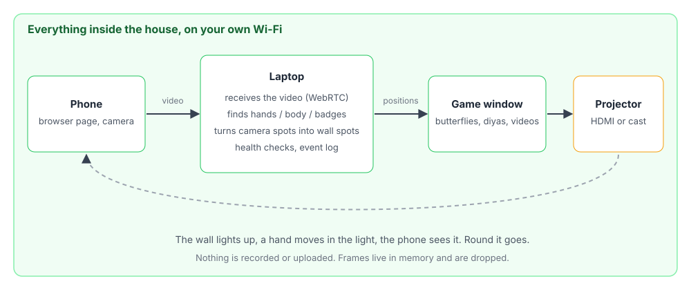
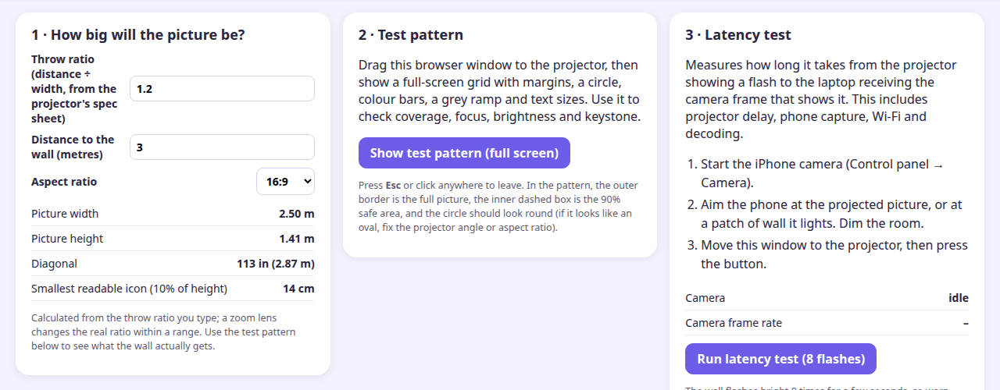
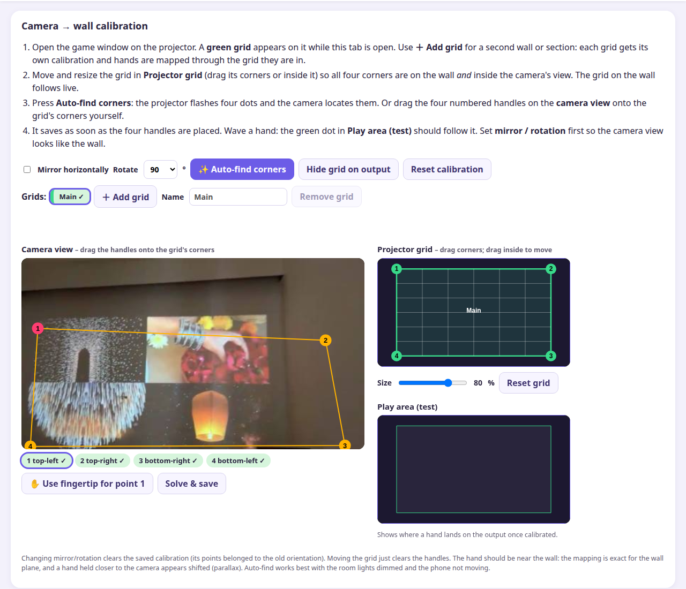

This started with a small idea: could I make something for the kids for Diwali that wasn't another screen they hold? A wall that notices them, with butterflies that come to a hand, diyas that light up when you stand near them, fireworks you can launch by jumping.

It ended up being a laptop, a phone and a projector, code written with Claude Code, and a list of things I didn't know about tracking people. This post is about the game and what I learned making it. Some of it is what worked, but more of it is what didn't, because that's where the learning was.

<figure>
  <video controls preload="metadata" playsinline style="width:100%;height:auto;border-radius:6px">
    <source src="/blog/butterfly-playground/kids-playing.mp4" type="video/mp4">
  </video>
  <figcaption>The kids at the wall: lighting diyas, popping balloons together, catching sweets.</figcaption>
</figure>

## What it is, in one picture

A phone on a stand watches the room. It sends video over my home Wi-Fi to a laptop. The laptop finds the people in the picture, works out where they are on the wall, and draws the game. The game window goes to the projector.



I set two rules at the start and they shaped a lot of choices. It all runs on the laptop: no cloud service, no account, no paid API. And no recording: video frames exist in memory long enough to be looked at, and then they're gone. There are kids in that picture, and I didn't want the project to be the reason their faces ended up on someone's server.

## Getting a game onto a wall

The projector is a big, bright, slightly dumb rectangle. I plugged it in over HDMI, Ubuntu saw it as a second display, and I dragged the game window onto it. A butterfly on the wall took no time at all.

HDMI trails a cable across the room, so I also tried casting. The projector has its own browser, but it has no mouse and the camera page needs a secure address, so that went badly. What worked was boring: in Chrome on the laptop, Cast, then Cast tab, pick the projector. I'd spent a while on the harder idea before trying the obvious one. Casting costs CPU, though, as the speed section below shows.



*The projector setup page. You type the throw ratio and the distance to the wall and it tells you how big the picture will be.*

A projector doesn't know your wall, and neither does the camera, so the app has to be told where the wall is. You mark the four corners of the projected picture in the camera's view, and from then on a hand seen by the camera can be placed on the wall. The same calibration also lets the projected picture be cut into pieces and bent to fit different parts of a wall, such as framed videos on a panelled wall. That's a side quest I haven't done yet, and this post is about the game.



*The calibration page. The camera's view is on the left with four handles on the corners of the picture, and the green grid on the right is what the projector draws.*

## The honest problem: finding hands

The plan for the games was simple. A child holds up a hand, a camera finds the hand, the butterfly goes to it. There's a good free library for hand tracking (MediaPipe) and on a photo of a hand it worked first time.

Then I tried a real wall.

A kid at a wall doesn't hold a hand up like a hand in a diagram. They touch the wall. So the hand is edge-on, or curled into a fist, or it's the back of the hand facing the camera, or half hidden by an arm. These are all cases the hand model is weakest at. It would lose the hand, then find it, then lose it, and the butterfly would jitter and give up.

I added smoothing, stable ids and a short "hold on to it for a moment" when the hand disappears. That helped the look of it but not the actual problem. The tracker wasn't wrong in a way I could filter. It just wasn't seeing.

## The pivot: track the whole body

The same library also does body pose: a skeleton of about thirty points, wrists and elbows and hips included. A wrist is much easier to find than a fist, because the arm leading to it is a big, obvious shape. So I tried an experiment on a separate branch: ignore the hand model, and treat the wrists from the body skeleton as the hands.

I tested it myself at the wall, touching it the way a kid would. It felt much better. The point stayed on the hand instead of flickering. Then the kids played with it and enjoyed it, which was the test I cared about. That was a feel test, not a measurement, and I should say so.

### What it costs

Body tracking is heavy. On my laptop, which is an old four-core one, it took between about 60 ms and 190 ms per frame, depending on what else the machine was doing. That means roughly 7 to 15 updates a second. When I was also casting the screen to the projector, the cast encoder took a big share of the CPU and tracking was at its slowest. The app shows a slow-tracking warning when that happens, which is how I noticed.

For butterflies, which drift, that's fine. For something that needs a quick reaction it's noticeable. Closing other programs helped a lot. So did switching to the lighter hands-only mode for games that don't need a body. An HDMI cable instead of casting would help more, and I haven't measured that yet.

### More than hands

Body tracking opened up other things too. The same skeleton can tell you a person jumped (hips go up and then come down) or is climbing (a wrist above the hip, hips rising). So I built a little Playroom Quest: jump on the stairs and you earn a laddu, climb the wall and you earn a sparkler, and when you've collected enough the wall bursts into fireworks and falling sweets. The jump and climb rules are scaled by each person's torso length so a small child and a tall adult both work.

## The next problem I didn't solve: who is who?

Pose tracking fixed "where is the hand", and immediately raised a new question: whose hand?

The skeleton gives you people-shaped things. It doesn't know that this one is the child who is supposed to be the rabbit and that one is the child who is the elephant. When two people cross, the ids can swap. For a game where each child becomes their own animal and stays that animal, something has to say which person is which.

Face recognition would do it. I decided not to go anywhere near that with children, and I didn't want to build the consent story it needs. My plan was a marker instead: a printed card with a bold colour and a bold shape taped to a child's top. A badge identifies a game character, not a person, and it comes off at the end of the day. I built a badge detector and a sheet of printable badges. Then I never ran the experiment on real kids. They were already enjoying the body-tracking version and I ran out of time before Diwali.

So I can't tell you whether it works. That idea belongs in a later game, a more involved one where it matters that your animal, your score or your collection follows you around, and where the game needs a memory of who is who. This one didn't need it.

## What I got wrong, in short

- I tested on photos and fake cameras for a long time. A photo of one hand is the easiest possible input.
- I tried the clever route for getting the picture to the projector before the obvious one.
- I trusted a feature because it looked right on my laptop, and not on the thing it was for.

None of these were caught by the tests. There are a few hundred automated tests, and they're useful, but the ones that matter most were done by standing in the room.

## Working with Claude on this

Like the other projects here, I built this with Claude Code. I set the rules: local only, no recording, no face recognition, and keep a log of what was verified and what wasn't. It wrote most of the code, the tests and the docs, and kept the progress log that I used to write this post.

It got things wrong too. It was confident about removing a faint watermark from a greeting GIF until I looked at the result and saw it was still there. The useful habit was a progress file with a "Not verified" column. Nearly every surprise came from something in that column.

## Try it yourself

You need a laptop, a phone and anything that makes a bright rectangle, even the laptop screen. A projector is nicer, but the games run in a normal window and work with a mouse before you touch a camera.

```bash
git clone <repo-url>      # the link will be here once the code is public
cd <repo-folder>
scripts/setup.sh      # once: Python environment, dependencies, pose model
scripts/start.sh      # run the server
scripts/doctor.sh     # anytime: what's wrong, and how to fix it
```

Open `http://localhost:8000/` on the laptop and press Play. For the camera, open the `https://` link it prints on your phone, accept the certificate warning, and tap Start camera. The setup guide in the repo has the rest, including a first-run checklist.

Some honest notes for anyone trying it:

- It works on my setup and I've only tested it on my setup. There is a list of things I haven't verified on real hardware in the README.
- The first setup needs internet once to download the pose model, about 6 MB. After that it runs offline.
- Don't put a camera on children without telling their parents and without thinking about where the pictures go. Here, they go nowhere, but check that for yourself in the code.

## What's next

- A more involved game where each player keeps an identity and some memory through the whole game. That's where badges, or something like them, would earn their place.
- Tune the jump, climb and "stand still" thresholds with real children instead of my guesses.
- Measure the delay from a hand moving to the wall reacting. I've estimated it, and I haven't measured it.
- A side quest: split the projected picture into framed pieces that fit the panels of my wall, and maybe add a second projector for a second wall.

## And the Diwali part

The reason for all this wasn't the projector. It was a few evenings of messing about with something that felt like play, and a house that looks a little different on the night. The kids lit diyas with a touch of the wall, popped balloons together and chased falling sweets, which is about all I wanted.
