In August I pulled out my old Lenovo Z51-70 and set it up again. It's a 2015 model with an i7-5500U, 8GB of RAM, a 1TB hard disk and Ubuntu, and it was very slow. Before spending money on a new laptop, I wanted to know whether this one could be saved.

Until recently, a job like this went one of two ways for me. Either the laptop went to a service centre, or I spent an evening watching YouTube videos of a laptop that looks a lot like mine but isn't quite.

This time I did almost all of it with Claude, from working out what was wrong to opening the laptop and swapping the parts myself. That last part is the bit I keep thinking about.

## Before: what was slowing it down

I didn't start with a shopping list. A little before 1am on 8 August, I opened Claude Code on the laptop and asked why it was so slow. It had a spinning hard disk and about 7GB of usable RAM, and an SSD came up early on.

Then I asked: when I have 7GB of memory, why is it hitting disk?

The answer was that the RAM was full of leftovers. A k3s cluster was running inside Docker, and the Hermes agent I'd installed in July was running as a background service. With memory full, the system was swapping to the hard disk, and on a spinning disk every swap was slow.

k3s was the stubborn one. `systemctl disable k3s` said there was no such service, and killing it only lasted until the next reboot. We traced the process, searched the disk and checked cron. The only k3s binary was inside Docker's storage, and the containers were set to restart, so Docker brought the cluster back on every boot.

The fix was to stop every container, switch off their restart policy and disable the Hermes service. That freed the memory, but the hard disk was still slow on its own, especially for booting, starting apps and IntelliJ's indexing. So the shopping list happened after all.

It started with a 512GB Lexar NQ100 SSD. I'd also found the second RAM slot was empty, so another 8GB stick of DDR3L went on, along with a ₹299 Zebronics SATA-to-USB adapter. I ran the list past ChatGPT against Lenovo's spec sheet before ordering, and the three parts came to about ₹11,500.

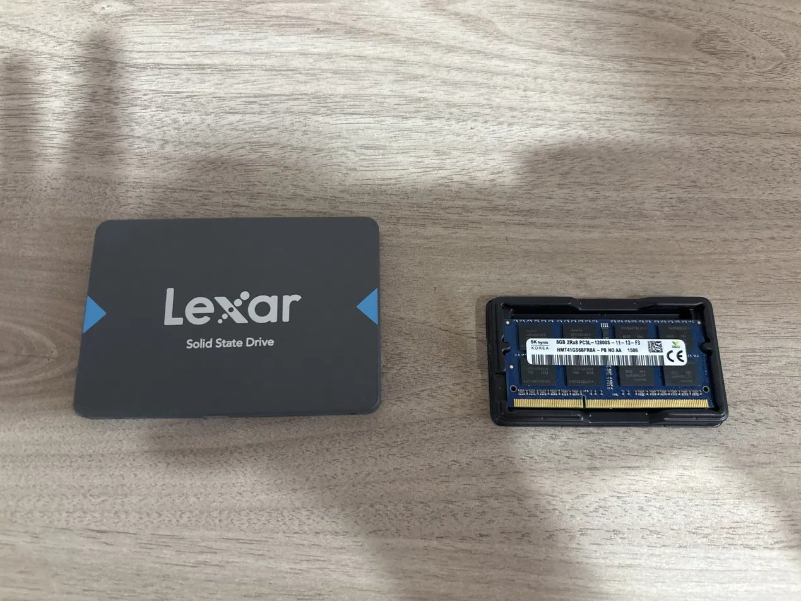

## Installing onto the SSD first

Claude Code, running on the laptop, wrote me a runbook in phases. The idea was to leave the old disk alone. Ubuntu would go onto the SSD while it sat outside the laptop on the USB adapter, and the laptop would only be opened once the SSD had booted and my files were across.

Installing an OS means restarting, and a restart takes Claude Code down with it. So I moved to the Claude app on my phone, brought the runbook over, and carried on there, sending photos of the screen at each step.

Getting into the installer was the first problem. I didn't have a pen drive, so the Ubuntu ISO went onto the hard disk with its own boot menu entry. But every time I tapped Esc to catch that menu, I landed at a bare `grub>` prompt instead.

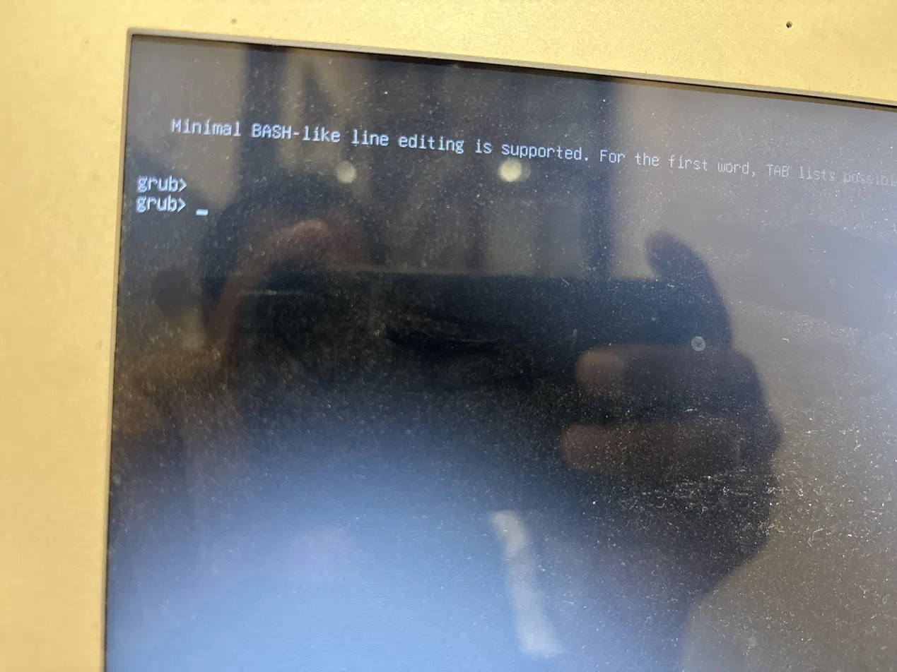

We tried a few things, including reinstalling the bootloader. What worked in the end was skipping the menu entirely. One command, `grub-reboot`, told the laptop to boot the installer once on the next restart.

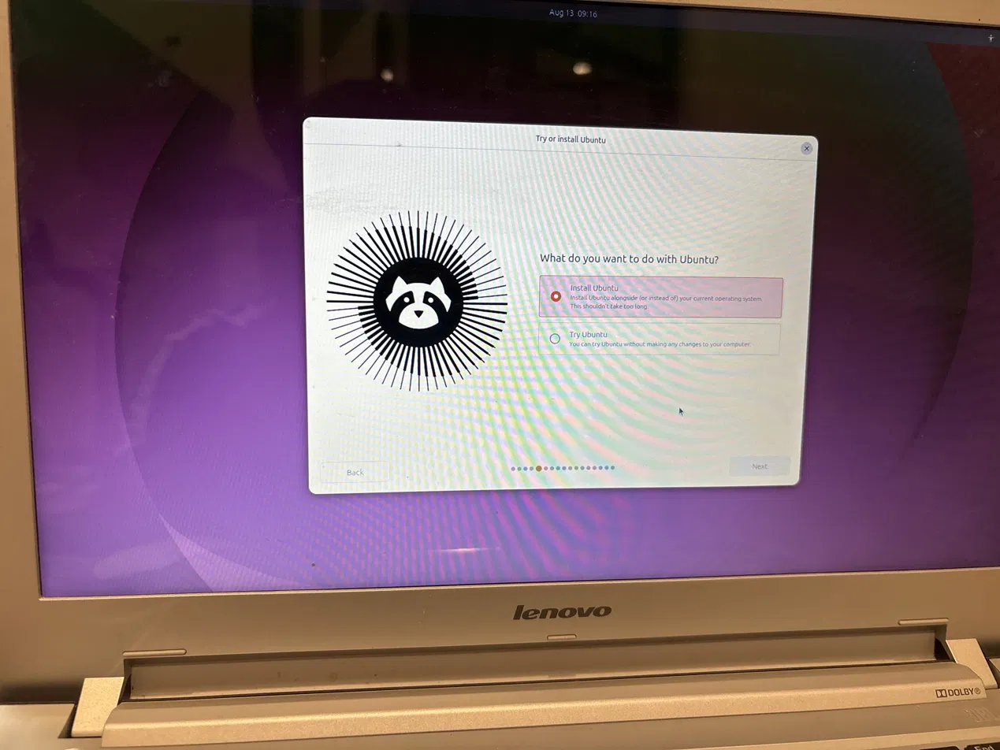

On the disk screen we matched the drives by size rather than name, because the names kept shifting. Then a 1.13GB partition kept appearing that I hadn't made. Claude treated it as a stray and had me delete it, but it kept coming back.

Eventually I noticed it appeared whenever I picked the SSD as the boot loader device. The installer was making its own EFI partition, so the one I'd made by hand wasn't needed. Once I removed mine, the install went through.

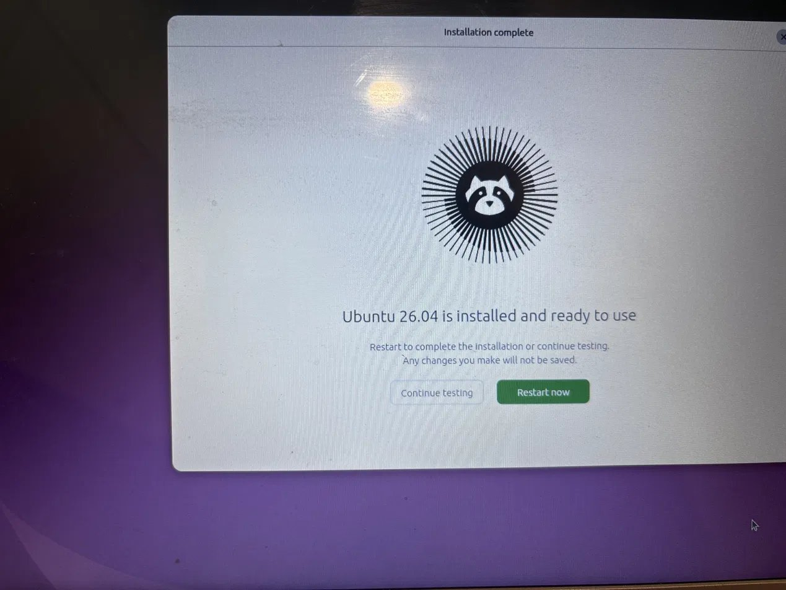

The final summary listed the hard disk as unchanged. Ubuntu 26.04 went onto the SSD, it booted over USB, and `rsync` copied 8.31GB of my home folder across. Only three files failed, all in a Mosquitto broker's folder that needed `sudo`.

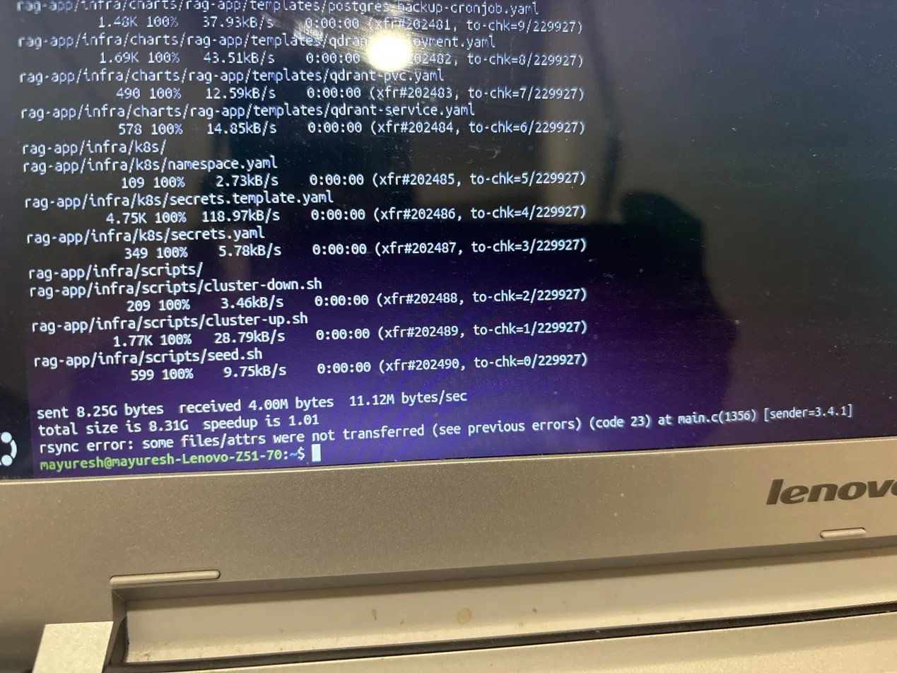

Even over USB, the laptop felt much faster.

## Opening it up

I kept 15 August, a holiday, for the hardware. The new RAM had arrived, so both upgrades could happen with the laptop opened once.

The bottom panel had seven or eight screws. My precision kit's bits were marked T5, T6 and so on, which are Torx, and nothing said PH. I laid them all out, sent a photo, and we found the cross tips by test-fitting them on a screw.

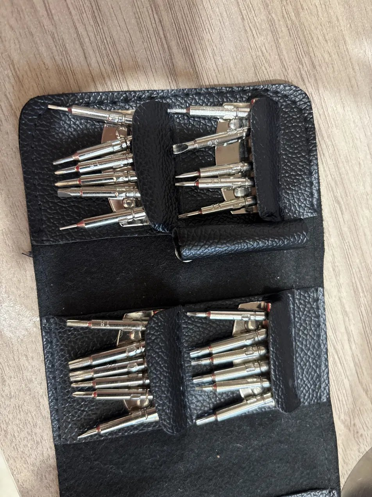

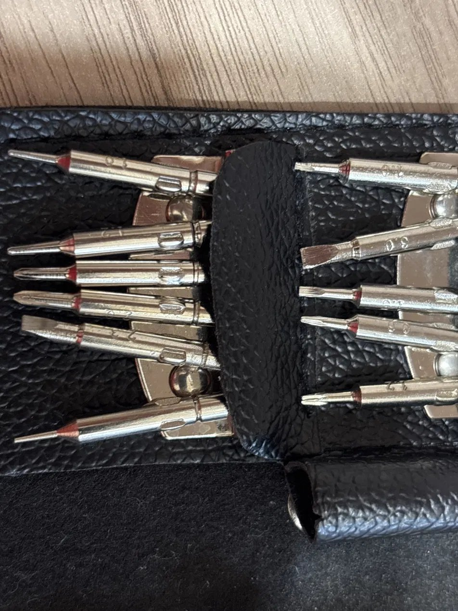

With every screw out, the cover still wouldn't come off. It seemed held in the middle. My guess was a screw somewhere I couldn't see, so I asked Claude to check the specs.

It searched Lenovo's hardware manual for the Z51-70 and found that on this model the keyboard has to come off first. A small hole in the base lines up with the keyboard latch, and a paperclip pushed through it releases the keyboard.

I didn't have a paperclip, so I used the thin flathead from the kit. With the keyboard out of the way, there was one more screw underneath, and loosening it freed the base. A stuck cover looks like it needs more force, which is how plastic cracks.

Inside, Claude found the RAM slots straight away: one stick in, one slot empty. It couldn't place the hard disk at first. When I sent another photo and said the silver block looked like the drive to me, it agreed.

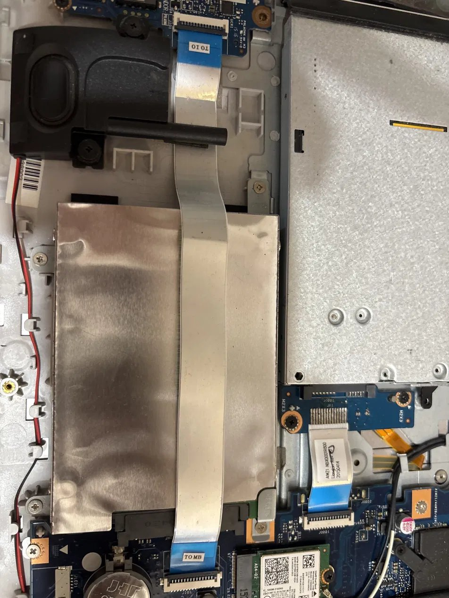

A ribbon cable marked TO IO and TO MB ran over the drive caddy, so I asked before touching it. The answer was to move it aside, not unplug it.

RAM went in first, since it was the easier job. I asked about the metal clips on the old stick, then which way up the new one went, and sent a photo to check it was seated.

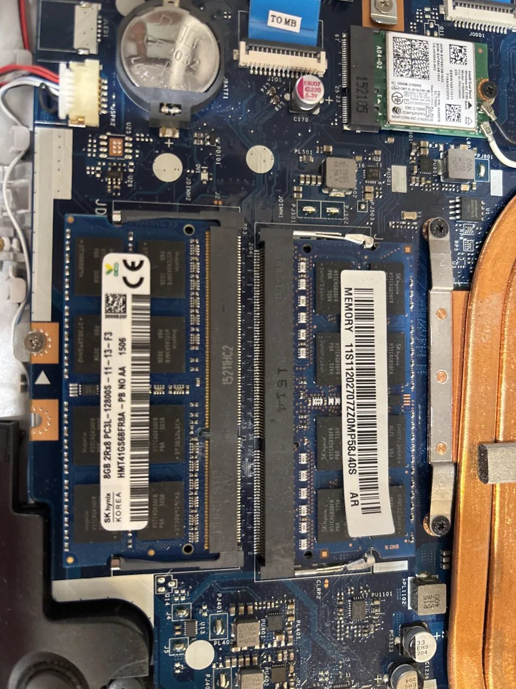

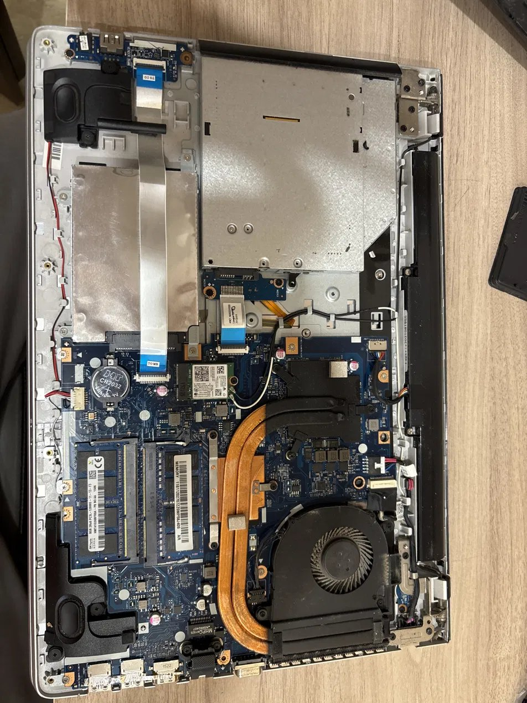

Then the hard disk slid away from its connector and came out, and the SSD took its place.

## The RAM that wouldn't show up

After closing up, I booted and ran `free -h`. It said 7.2GB, the same as before. `dmidecode` was blunter: the second channel had no module installed.

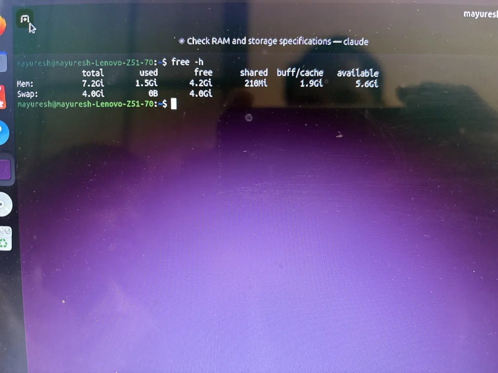

Claude's first guess was a badly seated stick, the most common cause, so I opened the laptop again. From my photo it spotted that the new stick's near edge sat slightly higher than the old one, with more of the gold contacts showing. I reseated it, closed everything up, and got 7.2GB again.

Next we swapped the two sticks between slots. Claude read the result as a bad slot at first. I pointed out that the old stick had now worked in both slots and the new one had failed in both, so the fault was following the stick. Claude agreed, and running the old stick on its own settled it.

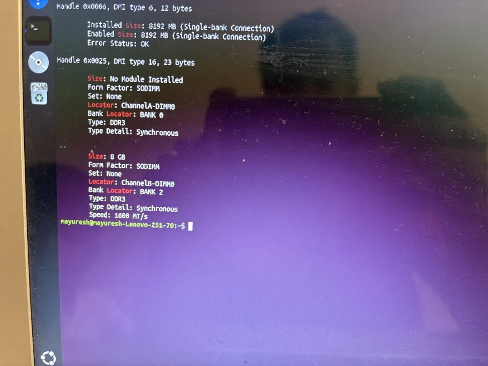

I even asked if some command could switch the stick on. Claude was clear that there isn't one, since the board detects RAM before Linux starts. Its last idea was to drain the board by holding the power button for 20 to 30 seconds, after checking the specs to confirm the battery couldn't be removed. That didn't help, so I ordered a replacement.

On 17 August, with the replacement in, `free -h` finally showed 15Gi, the full 16GB, with both channels at 1600 MT/s. Claude credited the power reset at first. It was the replacement.

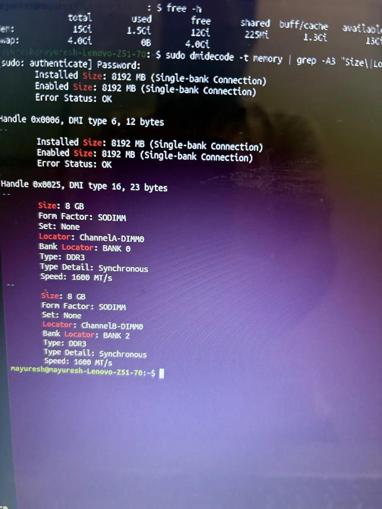

## After: the numbers

I didn't benchmark the old disk before taking it out, so the disk figures in the before column are typical numbers for a 5400rpm laptop drive. Everything in the after column was measured on 13 October, with IntelliJ and Firefox open.

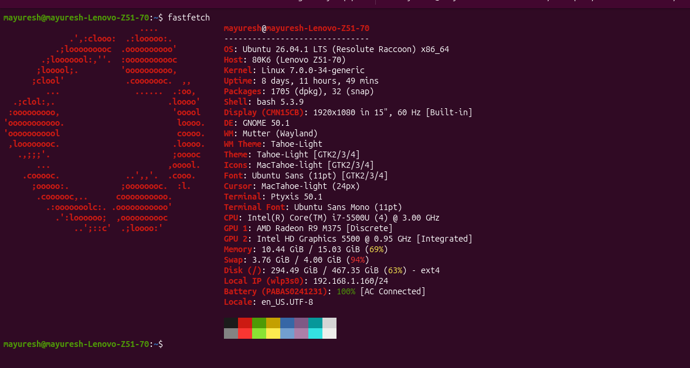

| Item | Before (8 Aug) | After (13 Oct) |
| --- | --- | --- |
| RAM | about 7GB usable | 15GiB (16GB installed) |
| Boot drive | spinning HDD | Lexar NQ100 512GB SSD |
| Always-on background load | k3s in Docker, Hermes gateway | none |
| Random 4K reads | 80-120 IOPS (typical) | about 8,000 IOPS |
| Access latency | 10-15 ms (typical) | about 0.12 ms |
| Sequential read | 80-110 MB/s (typical) | about 460 MB/s |

Random reads are the number that matters here. Booting, opening apps, IntelliJ's indexing and swapping all lean on them, and they went up roughly 80 times. Sequential reads only went up about four and a half times, which is why the MB/s figure undersells the difference.

In the 20-second fio run below, the SSD did 160,001 random reads. A typical laptop hard disk would manage about 2,000.

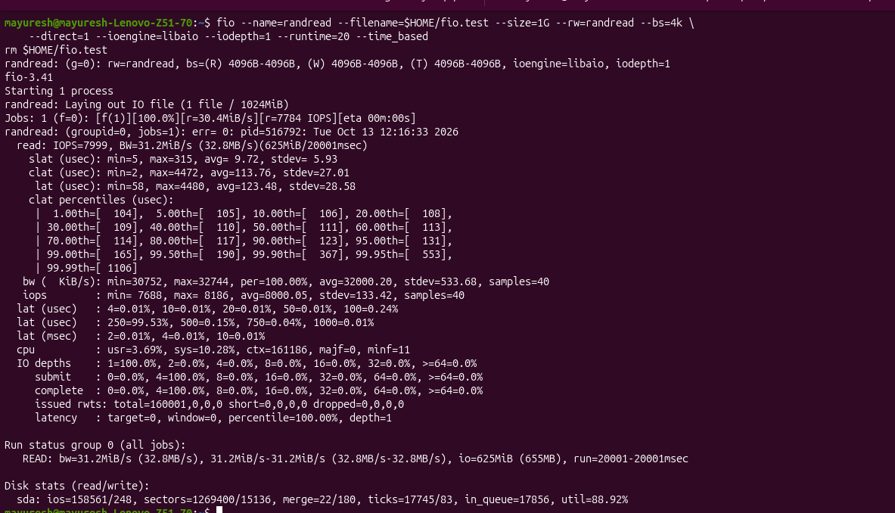

It boots in 32.5 seconds now. The BIOS takes 11.3 of those, and no disk can speed that up, so Linux itself takes about 21. And the 256GB SSD I first shortlisted would already be full, since the new install uses 295GB.

smartctl says the drive is healthy, with no reallocated sectors, and it runs at the full 6Gb/s SATA speed, so the laptop's port isn't holding it back.

Not everything changed. On 13 October, after eight days of uptime, swap was nearly full again, 3.76 of 4GiB in the fastfetch screenshot, mostly from IntelliJ and Firefox. The difference is that swap now lives on an SSD, where it hurts far less.

## What could have gone wrong

I don't want this to sound risk-free, because it isn't. Forcing that cover would have cracked it, and yanking the ribbon cable could have damaged a part that had nothing to do with the upgrade. A dead RAM stick is easy to mistake for a dead slot, and a `grub>` prompt is easy to panic at.

Claude was also wrong more than once. It treated the installer's own partition as a stray, it struggled to find the hard disk in my first photo, and it credited the wrong fix for the RAM. Each time, the correction came from me looking at what was in front of me and saying so.

Claude only sees what's in the photo. It can't feel a screw that won't turn or a clip that's about to snap. I'm the one holding the screwdriver, so the final call is mine.

It helped that the stakes were low. It's an old laptop, and the hard disk stayed untouched until the SSD had proved itself. I'd think twice before doing this for the first time on a machine I rely on for work.

## Why it still feels like a superpower

Even with all that, this changed how I think about a whole category of jobs. Any one of those snags is where I'd normally have stopped and booked a service centre visit. The information to get past them has been around for years in forums and manuals.

What's new is help that looks at my exact situation, in the photo I just took, and answers the next question, and the one after that. It also moved with me. When the restart took Claude Code down, I carried on from my phone without losing the thread.

The hard parts even felt familiar. Swapping the RAM sticks to see what the failure followed is the same move I'd make with a flaky service at work. It was a small job, an SSD and some RAM, but it's the first time a hardware fix felt like debugging. Things I used to hand off are now things I can try myself, carefully.

## What I want to try next

Next on my list is a home hub: one place where I can see every device on my home network and control them.

Security is the part that needs the most thought. A hub with access to everything at home is the last thing I want reachable from the internet. So the plan is to keep it on the home network only, with nothing exposed outside.

I also want it to show me which devices are sending data back, where it goes and how often. Most of what's connected at home talks to a server somewhere, and right now I don't have a clear picture of any of it. If a k3s cluster could keep restarting on my own laptop without me noticing, I'd rather not guess what the rest of the network is up to. Once I can see that, I can decide what needs to be online at all.

This carries a different kind of risk from the laptop. A problem inside a laptop usually shows itself fast. The missing RAM was obvious the first time I ran `free -h`. A mistake on the network can sit there quietly.

So I'll lean on Claude the same way, but check its work more closely and make sure I understand everything I end up running. I'll write about it once there's something worth showing.
